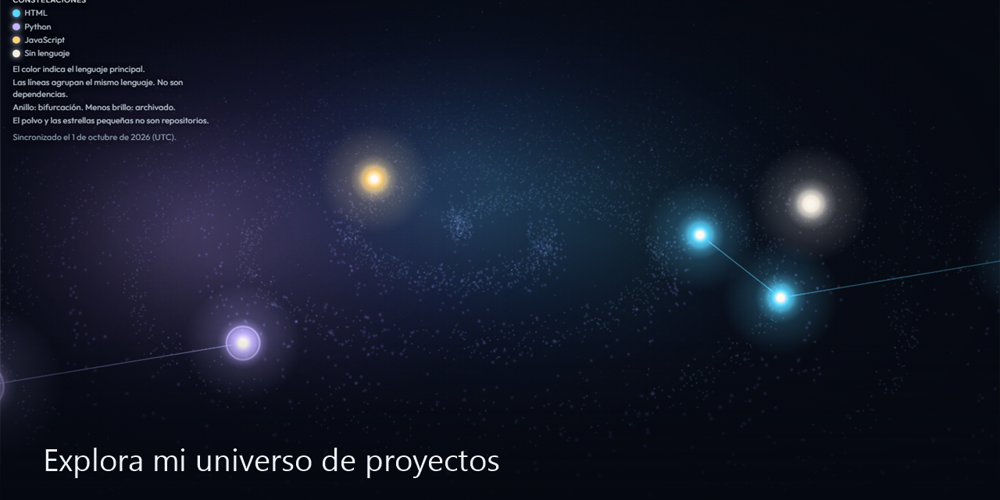

# Fernando Lizana

Ingeniero en Telecomunicaciones. Construyo software y automatizo su calidad.

## Especialidades

- Ingeniería en telecomunicaciones
- QA y automatización
- Monitoreo y confiabilidad
- Aplicaciones y sistemas con IA

## Proyectos

- [Espectro](https://github.com/FernandoLizana/Espectro) — monitor de audio para radios. El micrófono escucha el transmisor y guarda envío y recepción.
- [limpieza](https://github.com/FernandoLizana/limpieza) — limpiador de disco para Windows y Linux. Por defecto simula y no borra.
- [impulso](https://github.com/FernandoLizana/impulso) — app Android de frases en español, sin cuenta y sin conexión.
- [command-world](https://github.com/FernandoLizana/command-world) — tablero local de proyectos, con mapa, misiones y caja. Sin cuentas externas.
- [loteria-lab](https://github.com/FernandoLizana/loteria-lab) — laboratorio local de loterías. No predice sorteos.
- [navier-stokes-ai-lab](https://github.com/FernandoLizana/navier-stokes-ai-lab) — experimentos numéricos y verificación con ayuda de IA. No resuelve el problema del milenio.
- [PNPLab](https://github.com/FernandoLizana/PNPLab) — estudio empírico de IA en matemáticas formales: ChordWidth, evidencia computacional y Lean. No resuelve P versus NP.
- [centralizado](https://github.com/FernandoLizana/centralizado) — vitrina portable de cuatro piezas. Arte y código en la misma página.
- [mi-gestor](https://github.com/FernandoLizana/mi-gestor) — CRM local para un equipo pequeño.
- [laboratorio-radar](https://github.com/FernandoLizana/laboratorio-radar) — prospección local de comercios publicados en OpenStreetMap. No inventa fichas. La IA es opcional y no ve datos de contacto.
- [mosca](https://github.com/FernandoLizana/mosca) — laboratorio 3D de percepción y aprendizaje de una mosca de la fruta. No simula un cerebro completo.
- [nexo-cerebro](https://github.com/FernandoLizana/nexo-cerebro) — laboratorio local de agentes. Nexus y Nira, en el equipo.
- [el-tejido-arcano](https://github.com/FernandoLizana/el-tejido-arcano) — laboratorio de grafos de similitud simbólica: color, símbolos y semántica medidos como red.

[Explorar los proyectos](https://fernandolizana.github.io/)

## Enlaces

- Portafolio: [fernandolizana.github.io](https://fernandolizana.github.io/)
- GitHub: [@FernandoLizana](https://github.com/FernandoLizana)
